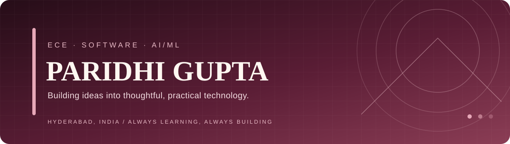

 

---

## ✦ About

I'm a second-year **B.Tech Electronics and Communication Engineering** student interested in building software that solves practical problems.

My work spans **full-stack development, backend systems, AI/ML, and hardware-software integration**. I enjoy understanding how systems work end to end — from the underlying logic to the experience people interact with.

I'm currently strengthening my software engineering foundations while exploring intelligent applications.

## ✦ Tech Stack

**Languages**

**Frontend & Backend**

**Data, Tools & Hardware**

---

## ✦ Featured Projects

### [BULLSEYE AI](https://github.com/paridhigupta-23/BULLSEYE-AI)
**AI-powered quantitative research & paper-trading platform**

A full-stack platform combining historical market data, machine learning, quantitative analysis, and simulated trading. Built around a NIFTY 50 historical dataset, with investor, broker, and practice-trading experiences.

`React` · `TypeScript` · `Node.js` · `SQLite` · `Machine Learning`

### [IASYN AI](https://github.com/vanshikaa0414/IASYN_AI)
**AI-assisted knee rehabilitation monitoring**

A healthcare-focused project exploring computer vision, machine learning, and sensor-based movement monitoring to support knee rehabilitation.

`Python` · `Computer Vision` · `PyTorch` · `ESP32`

### SensorGrid-3
**Sensor monitoring & backend services**

A backend project for managing device information and sensor readings through REST APIs and a PostgreSQL database.

`Node.js` · `Express` · `PostgreSQL` · `REST APIs`

### Battle Game Arena
**Interactive algorithm visualisation**

A React-based project exploring interactive experiences and visual representations of programming concepts.

`React` · `JavaScript` · `Vite`

### [Spidy](https://github.com/paridhigupta-23/spidy)
**Pixel-art virtual pet game**

A responsive browser game built with plain HTML, CSS, and JavaScript, featuring character interactions, game stats, unlockable decorations, and a mini-game.

`HTML` · `CSS` · `JavaScript`

---

## ✦ What I'm Exploring

| SOFTWARE ENGINEERING | AI & MACHINE LEARNING | SYSTEMS |
|:---:|:---:|:---:|
| Full-stack applications | Intelligent applications | Hardware-software integration |
| Backend development | Practical ML workflows | Embedded systems |
| Problem solving | Computer vision | Networking fundamentals |

## ✦ GitHub

---

**BUILD · LEARN · EXPERIMENT · SHIP**

Hyderabad, India · Always learning, always building.

